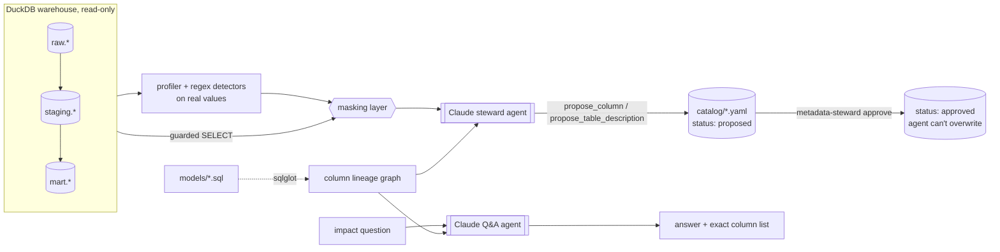

# metadata-steward

**An LLM data steward that documents a warehouse, classifies PII and answers lineage
questions without ever seeing the PII itself.**

Claude crawls a warehouse one table at a time. For each table it profiles the columns, reads the
model SQL, follows column-level lineage and runs targeted aggregate queries. It then proposes a
catalog entry: a description, a PII category, a confidence and the evidence for every column. A
person approves the entries, and the agent can never overwrite an approved one. A separate Q&A mode
answers impact questions like *"what breaks if we drop this column?"* using lineage parsed from the real SQL.

[](https://github.com/jinwoojang21/metadata-steward/actions/workflows/ci.yml)



## Why it's built this way

| Decision | Reason |
|---|---|
| **The model never sees raw PII.** Every sample and SQL result goes through a masking layer (`999-99-9999`, `<email>`, `J**** S****`, `1987-04`). Regex detectors run on the *real* values inside the database, and only their hit rates are passed to the model. | A steward that has to read SSNs to classify them can't be pointed at production. A test checks that this holds (see below). |
| **Columns with ≤10 distinct values are shown as-is.** | Enums such as `clearance_lvl` and `cur_cd` can't single out a person, and the model needs the real values to judge sensitivity. |
| **Lineage comes from parsing SQL** (sqlglot), not from the LLM | Impact analysis has to be exact. The model uses the lineage graph and reasons about what each transform keeps: `sha256(email)` vs `split_part(email,'@',2)`. |
| **Tables are documented in dependency order**, and the agent can read upstream entries | Classifications in staging and mart stay consistent with their raw sources. |
| **The agent only writes proposals**, and `approve` locks an entry | A person stays accountable for the catalog. Re-running the agent can't undo a human correction (there's a test for this). |
| **`finish_table` fails until every column has a proposal** | The model can't quietly skip a hard column. |
| **The warehouse connection is read-only, with a guarded SELECT** | The agent can't change anything, no matter what it tries. |

### Threat model

The masking layer protects against *accidental* exposure. That covers the PII that would otherwise
pass through prompts, logs and provider retention every time the model looks at a sample. It does
not fully protect against a model actively trying to rebuild values, for example with
`SELECT ph_num % 10000`. For that, add query-pattern restrictions or run the agent against a
de-identified replica.

`test_no_raw_pii_reaches_the_model` calls every tool on every table and column: profiles, `SELECT *`
over every table, lineage, model SQL and catalog reads. It then checks that none of over 5,000 real
names, emails, phone numbers, SSNs, DOBs, addresses, IPs or device IDs appears anywhere in what the
model would receive.

## The demo warehouse

`metadata-steward seed` builds a synthetic warehouse made to trip up scanners:

| Trap | What a naive scanner does |
|---|---|
| `raw.crm_contacts.c3`: DOB stored as `YYYYMMDD` text under a meaningless name | Misses it |
| `raw.orders_ext.ref_code`: `120-05-0001`, shaped exactly like an SSN but actually an order reference (5 prefixes, sequential suffix) | Flags it as an SSN, three times as it flows downstream |
| `raw.orders_ext.notes`: free text where ~8% of rows contain an email or phone number | Misses it (detector rate is too low) |
| `raw.hr_employees.salary_amt`, `clearance_lvl`: no PII pattern, but HR-sensitive | Misses them |
| `mart.dim_customer.email_domain`: named "email", but only the domain survives | Flags it as an email |
| `ph_num` stored as a BIGINT, `email_hash` as `sha256(email)`, `ssn_last4`, `birth_year`, `zip3` | Mixed results |

## Quick start

```bash
pip install -e ".[dev]"
cp .env.example .env                 # add ANTHROPIC_API_KEY for the Claude agent
metadata-steward seed
metadata-steward document            # proposes entries for all 10 tables -> catalog/*.yaml
metadata-steward review              # proposal status, sensitivity, confidence
metadata-steward approve raw.hr_employees --by justin
metadata-steward ask "If we drop raw.crm_contacts.eml_addr, which mart columns break?"
metadata-steward lineage raw.crm_contacts.tax_id         # deterministic, no LLM
metadata-steward export --out CATALOG.md
```

Without an API key, `document` uses the rule-based baseline.

## Evals

```bash
metadata-steward evals --agent baseline        # CI, every push
metadata-steward evals --agent claude --qa     # manual CI job (needs ANTHROPIC_API_KEY)
```

- **PII classification:** all 81 columns are scored against [`evals/ground_truth.yaml`](evals/ground_truth.yaml).
  Some columns accept more than one answer (e.g. `birth_year` can be `quasi_identifier` or `date_of_birth`).
  Reported as category accuracy, binary PII precision, recall and F1, and accuracy on the 9 **hard** columns.
- **Lineage Q&A:** 5 impact-analysis questions in [`evals/lineage_questions.yaml`](evals/lineage_questions.yaml),
  graded on whether the answer names exactly the right columns.

### Results

_Claude results will be added after the first manual eval run._

Rule-based baseline (column-name patterns + regex detectors):

| columns | category accuracy | PII precision | PII recall | PII F1 | FP | FN | hard columns |
|---|---|---|---|---|---|---|---|
| 81 | 89% | 90% | 85% | 0.88 | 3 | 5 | **0/9** |

## Project layout

```
models/{staging,mart}/*.sql    dbt-style models (lineage is parsed from these)
evals/                         ground truth + lineage questions
src/metadata_steward/
  seed.py                      synthetic warehouse with PII traps
  models.py                    model discovery, dependency order, build
  lineage.py                   column-level lineage via sqlglot
  privacy.py                   detectors + masking
  warehouse.py                 read-only access, profiling, guarded SQL (all masked)
  catalog.py                   YAML catalog, proposal/approval workflow
  agent/tools.py               tool schemas + executor with audit trace
  agent/loop.py                Claude tool-use loop
  agent/baseline.py            rule-based scanner (same tools)
  steward.py                   orchestration (document / ask)
  evals.py                     scoring
tests/                         30 tests: PII-leak sweep, SQL guard, approval lock, scripted Claude loop
```

## License

MIT
